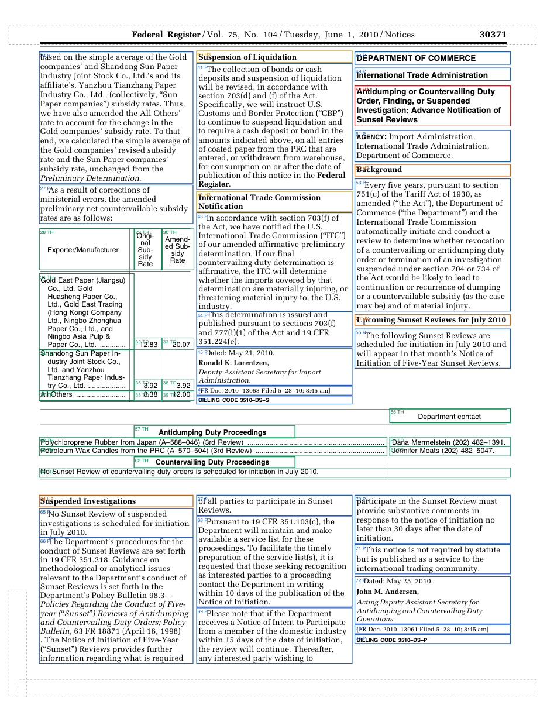
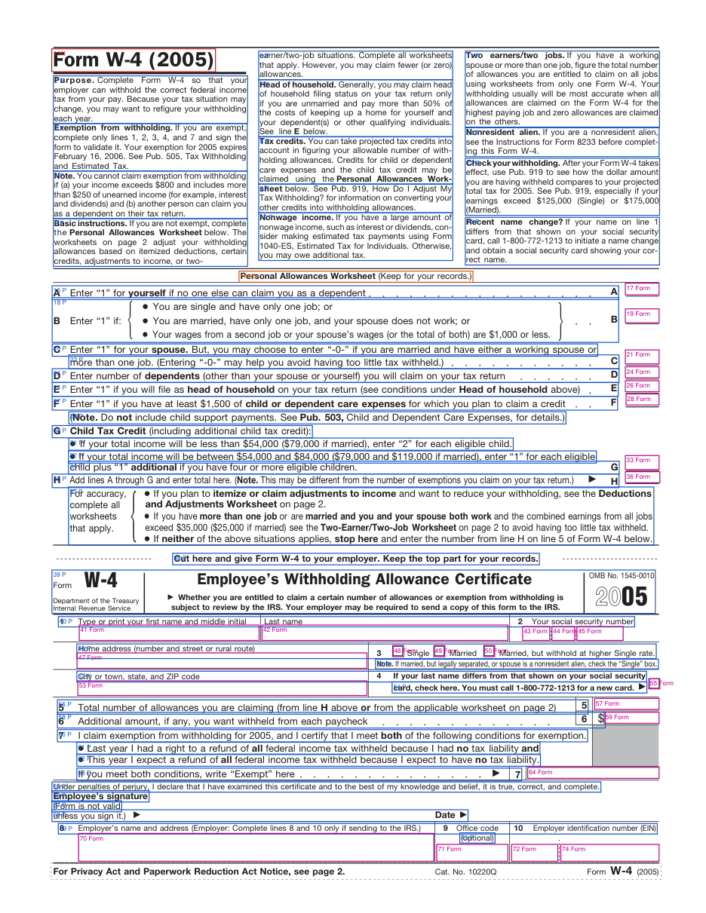

# PDF Accessibility Remediation: Work Samples

Three public-domain U.S. federal PDFs, remediated **in place** to a PDF/UA-1 structure (the technical standard behind WCAG 2.1 AA for PDFs), and validated with [veraPDF](https://verapdf.org) 1.30.3 using the PDF/UA-1 profile. The documents are a multi-column Federal Register notice with data tables, an agency form, and a two-page fillable IRS form.

The visual page is unchanged in all three. Rendered before and after at 100 dpi, they are pixel-identical. Only the structure that assistive technology uses was added or repaired.

Author: **Harlley Bastos**, senior software engineer, based in Brazil (UTC-3)
[harlleybastos@hotmail.com](mailto:harlleybastos@hotmail.com) · [linkedin.com/in/harlleybastos](https://www.linkedin.com/in/harlleybastos)

## Results

| Sample | Pages | veraPDF PDF/UA-1 before | veraPDF PDF/UA-1 after | Visual change |
|---|---|---|---|---|
| [Federal Register notice 2010-13068](samples/federal-register-2010-13068) | 2 | non-compliant: 10 failed rules, 1,004 failed checks | **compliant, 0 failed checks** (13,522 passed) | none |
| [OPM 71 Request for Leave (form)](samples/opm-71-leave-request) | 1 | non-compliant: 12 failed rules, 437 failed checks | **compliant, 0 failed checks** (9,296 passed) | none |
| [IRS Form W-4 (2005), fillable](samples/irs-w4-2005) | 2 | non-compliant: 12 failed rules, 1,375 failed checks | **compliant, 0 failed checks** (27,217 passed) | none |

The full machine report (veraPDF results and structural checks for every before/after file) is in [`qa/qa-report.html`](qa/qa-report.html). Each sample folder has `before.pdf`, `after.pdf` and `reading-order.txt`. The last one is the structure tree in the order a screen reader traverses it, with headings, table header scopes and IDs, and form field accessible names.

## What was done

### 1. Federal Register 2010-13068: untagged, 3 columns, 2 notices, 2 data tables
- Built the full tag tree from scratch, with reading order column by column. Paragraphs that continue into the next column or page are joined into one element.
- Headings: notice titles as H1, sections as H2/H3. Footnotes are `Note` elements with IDs.
- **Table 1** (subsidy rates) has column headers and row headers (`Scope`). Dot leaders ("Paper Co., Ltd. .........") are split from the company name and marked as artifacts, so they are not read aloud. Name, leader and both rates were drawn by a single text operator, so each piece was positioned from the font's glyph widths.
- **Table 2** (sunset review contacts) has group header rows spanning both columns, so it uses the `Headers`/`ID` association for unambiguous cell-to-header mapping.
- The running header, page numbers, printer slugs and rules are marked as artifacts.
- The hidden GPO digital-signature field is tagged as a `Form` element with an accessible name. **Note:** any modification invalidates the GPO's original digital signature. That is expected in remediation, and the publishing agency re-signs.

### 2. OPM 71: already tagged, but failing
- Added the document language (`en-US`), a title shown in the window title bar, and the PDF/UA identifier.
- Tab order now follows the structure (`/Tabs /S`).
- A non-standard `/Page` tag (no role map) became `/Part`. The form title, which was a paragraph, became H1.
- **Layout tables** (the visual grid of the form, announced as "table with 7 rows") are re-tagged as `Div`. The context comes from each field's accessible name, which was already complete on all 71 fields.
- 221 untagged vector graphics (rules, boxes, shading) are marked as artifacts.
- Optional-content configuration fixed: added `/Name` and removed `/AS`, as PDF/UA 7.10 requires. The log records the side effect for the client: the print-only layer no longer switches on automatically when printing.
- Every change is listed in [`remediation-log.json`](samples/opm-71-leave-request/remediation-log.json).

### 3. IRS Form W-4 (2005): untagged fillable form, 45 fields, 4 lookup tables
- The structure covers both pages: instructions in 3 columns, both worksheets, the certificate and the Two-Earner/Two-Job tables.
- **All 45 fields had no accessible name.** Each one now has a complete name: line number, instruction and unit. Example: *"Line 6: additional amount, if any, you want withheld from each paycheck, in dollars"*. The three marital-status boxes are announced as "Single", "Married", and "Married, but withhold at higher Single rate".
- **Explicit tab order** for the certificate: line 1 → SSN in 3 parts → address → line 3 options → city → lines 4–10.
- **Table 1** (Married Filing Jointly) is one logical table printed in two visual columns, newspaper style. It is tagged as a single table, with row headers spanning 4 and 16 rows (`RowSpan`). The second spans both visual columns. The repeated headers in the second visual column are marked as artifacts.
- Grouping braces and arrow and bullet glyphs (Pi fonts) are decorative, so they are marked as artifacts. They also got Unicode mappings, because the source font's `ToUnicode` map was incomplete.
- Checkbox "on" appearances used a non-embedded ZapfDingbats glyph. They are redrawn as vector check marks, which look the same and need no font.
- Hidden printer instructions outside the visible page ("I.R.S. SPECIFICATIONS — TO BE REMOVED BEFORE PRINTING", 57 text runs) are marked as artifacts.

## How it was verified
1. **veraPDF 1.30.3, PDF/UA-1 profile**: the machine-checkable conditions of ISO 14289-1 (Matterhorn Protocol).
2. **Structural checks:** tags, language, title, alt text, table headers, form field names, tab order, fonts and security.
3. **Pixel comparison** of every page, before and after (0 differences).
4. **Reading order export** (`reading-order.txt`), reviewed element by element.

## What is not claimed here
- **No manual assistive-technology pass (NVDA/JAWS) has been performed on these samples yet.** Automated validation covers only part of the Matterhorn Protocol. Judgment checks such as alt-text quality, logical reading order and header meaning were reviewed from the structure exports, not with a screen reader.
- No PAC report is included.
- These are demonstration files, not official versions of the documents. **Form W-4 (2005) is historical: do not use it for tax purposes.**

## Source documents
U.S. Government works (public domain, 17 U.S.C. § 105):
- Federal Register Vol. 75, No. 104, pp. 30370–30371 (govinfo.gov, FR Doc. 2010-13068 and 2010-13061)
- OPM Form 71 (opm.gov)
- IRS Form W-4 (2005), prior-year forms archive (irs.gov)

Remediation was done with in-house tooling (Python) for in-place tagging, font repair and QA. The tooling is not published in this repository.
